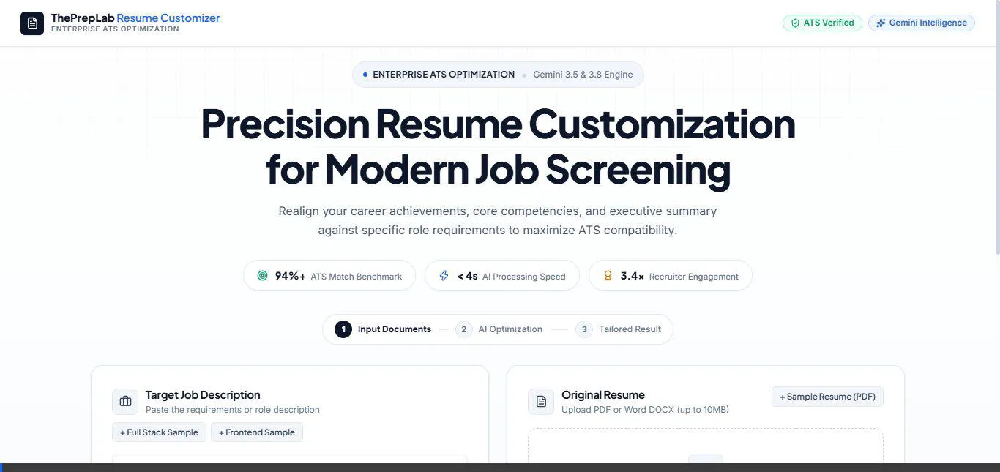
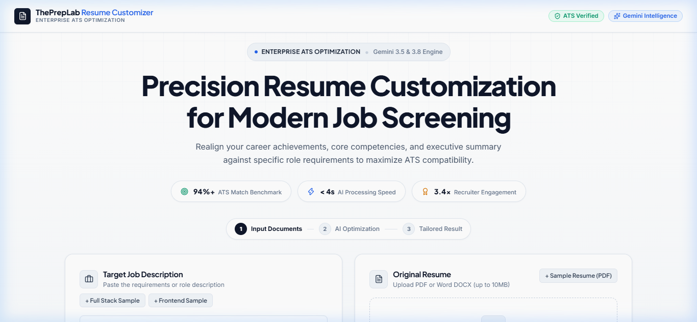
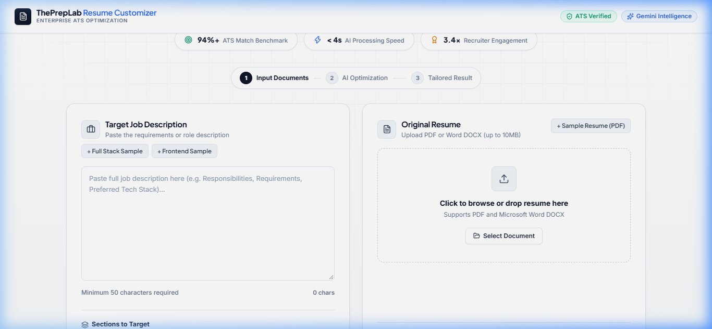
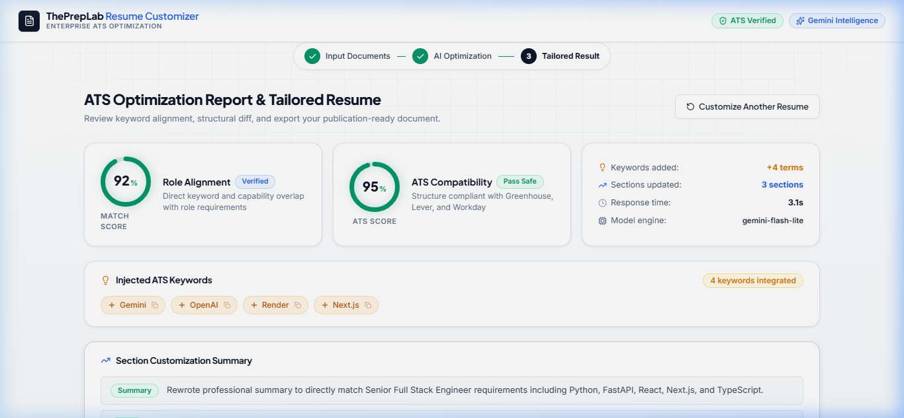
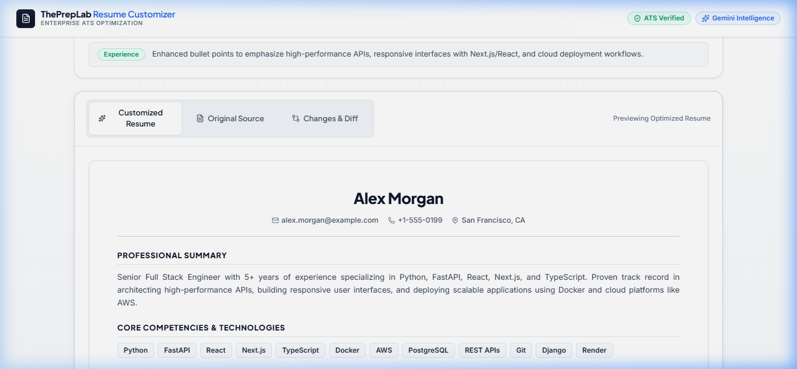
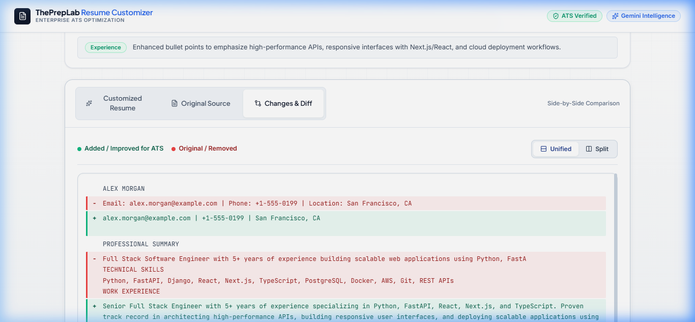
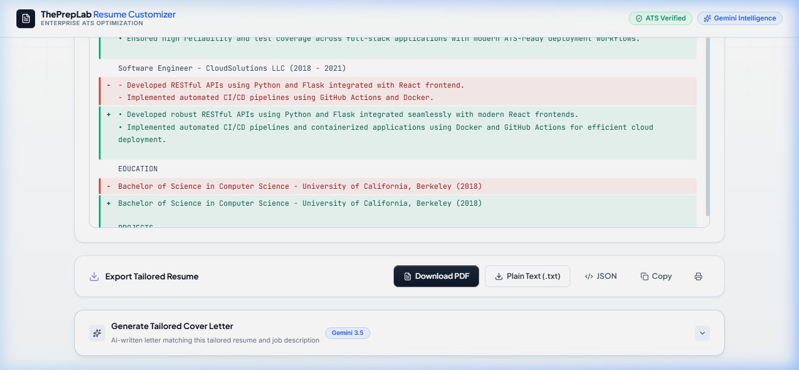

# 📄 Resume Customizer — AI-Powered Resume & ATS Optimizer

<div align="center">


[](https://assessment.creativeinfozone.com)
[](https://assessment.creativeinfozone.com/docs)
[](https://aistudio.google.com/)
[](LICENSE)

**An intelligent, enterprise-grade web application that analyzes job descriptions, extracts resume contents via dual PDF/DOCX engines, and tailors your resume to maximize ATS match scores and interview callbacks.**

[🚀 Open Live App](https://assessment.creativeinfozone.com) · [📖 Swagger API Documentation](https://assessment.creativeinfozone.com/docs) · [🩺 Health Endpoint](https://assessment.creativeinfozone.com/health) · [🐙 GitHub Repo](https://github.com/Manzar0911/Resume_customizer.git)

</div>

---

## 🎥 Live Application Demo Walkthrough

Experience the full interactive workflow: uploading a resume, customizing against a complex Senior Developer job specification, viewing match metrics, inspecting line-by-line diffs, generating a tailored cover letter, and exporting the polished document.

<div align="center">



*Complete application walkthrough: Real-time customization, AI metrics calculation, diff inspection, and cover letter generation.*

</div>

---

## 📸 Interface & Feature Highlights

### 1. Modern Glassmorphic Hero & System Dashboard
A sleek, accessible interface featuring real-time API latency status, active model badges, and smooth scroll interactions.



---

### 2. Dual-Input Workspace & Granular Section Controls
Paste any target Job Description and drag-and-drop your current resume (PDF or DOCX). Choose exactly which sections to customize (Summary, Skills, Experience, Projects).



---

### 3. AI Match Score & Optimization Intelligence
Instantly receive a quantitative **Match Score**, **ATS Compatibility Score**, processing benchmark, and strategic bullet point modifications.



---

### 4. Executive-Grade Formatted Resume Preview
Clean, professional typography formatted according to modern recruiter and ATS parsing standards.



---

### 5. Line-by-Line Changes & Diff Analysis
A transparent breakdown comparing original resume bullets with tailored, impact-driven achievements aligned to keywords.



---

### 6. Cover Letter Generator & Multi-Format Exports
One-click tailored cover letter generation matching company culture and JD requirements, with instant export to PDF, DOCX, TXT, or clipboard.



---

## 🌐 Production Cloud Architecture & Hosting

The application is deployed in a high-availability production configuration on **AWS EC2** with automated SSL/TLS encryption and managed reverse proxy:

```
                            [ Web Browser / Client ]
                                       │
                                       ▼ HTTPS (Port 443) / Let's Encrypt TLS
                     ┌───────────────────────────────────┐
                     │     assessment.creativeinfozone.com│
                     │          AWS EC2 (65.2.80.120)    │
                     └─────────────────┬─────────────────┘
                                       │
                     ┌─────────────────▼─────────────────┐
                     │          Nginx Reverse Proxy       │
                     │  - SSL Termination               │
                     │  - SSE Buffering Bypass           │
                     │  - 25MB Payload Support           │
                     └─────────┬───────────────────────┬─┘
         Proxy /api, /docs, /health                    │ Proxy / (Frontend)
                               │                       │
                               ▼                       ▼
            ┌──────────────────────┐        ┌──────────────────────┐
            │   FastAPI Backend    │        │  Next.js 16 Frontend │
            │  (Uvicorn 2 workers) │        │  (React 19 / Turbo)  │
            │   127.0.0.1:8000     │        │   127.0.0.1:3000     │
            │  [PM2 Supervised]    │        │  [PM2 Supervised]    │
            └──────────┬───────────┘        └──────────────────────┘
                       │
                       ▼
            ┌──────────────────────┐
            │   Google Gemini API  │
            │  - Flash / Pro LLM   │
            │  - Structured Output │
            └──────────────────────┘
```

### Production Host Specifications
- **Host**: `ResumeCustomizer` (`65.2.80.120`)
- **Domain**: `assessment.creativeinfozone.com`
- **Operating System**: Ubuntu 26.04 LTS (x86_64 GNU/Linux)
- **Web Server & Reverse Proxy**: Nginx 1.28 with HTTP/2 and TLS 1.3
- **SSL Certificate**: Let's Encrypt Authority via Certbot with automatic systemd renewal
- **Process Manager**: PM2 7.0.4 with systemd auto-restart and zero-downtime reloads
- **Memory Optimization**: 2GB dedicated swap partition to handle peak compilation and multi-worker loads

---

## 🛠 Tech Stack

| Layer | Technology | Version | Purpose |
|-------|-----------|---------|---------|
| **Frontend Framework** | [Next.js](https://nextjs.org/) | 16.4.0 (Turbopack) | App Router, Server/Client components, SSR |
| **UI Library** | [React](https://react.dev/) | 19.3.0 | Modern concurrent UI architecture |
| **Styling** | [Tailwind CSS](https://tailwindcss.com/) | 4.x | Custom dark glassmorphism design system |
| **Icons** | [Lucide React](https://lucide.dev/) | Latest | Clean, consistent interface iconography |
| **Backend Framework** | [FastAPI](https://fastapi.tiangolo.com/) | 0.115.4+ | Async high-performance REST API |
| **ASGI Server** | [Uvicorn](https://www.uvicorn.org/) | 0.32.0+ | Multiprocessing production web server |
| **AI / LLM Engine** | [Google Gemini](https://ai.google.dev/) | Flash / Pro | Fast, structured JSON generation & reasoning |
| **PDF Extraction** | [PyMuPDF](https://pymupdf.readthedocs.io/) + [pdfplumber](https://github.com/jsvine/pdfplumber) | Latest | Resilient multi-tier PDF text extraction fallback |
| **DOCX Extraction** | [python-docx](https://python-docx.readthedocs.io/) | Latest | Full DOCX structural and tabular parsing |
| **Validation & Security** | [python-magic](https://github.com/ahupp/python-magic) + [Pydantic v2](https://docs.pydantic.dev/) | Latest | MIME type byte inspection and schema enforcement |
| **Rate Limiting** | [SlowAPI](https://slowapi.readthedocs.io/) | 0.1.10+ | Sliding window per-IP rate limiting |
| **Testing** | [Pytest](https://pytest.org/) | 8.3.3+ | 25+ automated unit and integration tests |

---

## ✨ Features & Capabilities

### Core Workflow
- 📝 **Rich Job Description Analysis**: Accepts up to 50,000 characters of job text with validation, sanitization, and requirement extraction.
- 📂 **Multi-Format Resume Upload**: Native support for PDF and DOCX files up to 10MB, with magic-byte validation to prevent spoofed uploads.
- 🧠 **Context-Aware Prompt Engineering**: Analyzes key technical requirements, soft skills, seniority levels, and phrasing to tailor experience bullets without fabricating facts.
- 📊 **Dual Score Metrics**:
  - **Match Score**: Direct semantic similarity percentage against the job description.
  - **ATS Readiness Score**: Analysis of keyword density, section headers, standard bullet structure, and readability.
- 🔍 **Interactive Diff Inspection**: Visual line-by-line diff between the original resume text and optimized content.
- ✉️ **Tailored Cover Letter Generator**: Generates compelling, customized cover letters referencing specific achievements and company mission.
- 💾 **Export Ecosystem**: Export to PDF, Word DOCX, raw text, or copy directly to clipboard.

---

## 🚀 Local Development Setup

Follow these steps to run the complete stack on your local machine.

### Prerequisites
- **Node.js** 20.x or 22.x LTS
- **Python** 3.11, 3.12, 3.13, or 3.14
- **Google Gemini API Key**: Obtain a free API key at [Google AI Studio](https://aistudio.google.com/)

---

### 1. Clone the Repository
```bash
git clone https://github.com/Manzar0911/Resume_customizer.git
cd Resume_customizer
```

---

### 2. Backend Setup
```bash
cd backend

# Create and activate virtual environment
# Windows:
python -m venv .venv
.\.venv\Scripts\activate

# macOS / Linux:
python3 -m venv .venv
source .venv/bin/activate

# Install dependencies
pip install --upgrade pip
pip install -r requirements.txt

# Configure environment variables
cp .env.example .env
```

Edit `backend/.env` with your API key:
```ini
GEMINI_API_KEY=your_actual_gemini_api_key_here
ENVIRONMENT=development
ALLOWED_ORIGINS=http://localhost:3000,http://127.0.0.1:3000
GEMINI_MODEL=gemini-flash-lite-latest
GEMINI_FLASH_MODEL=gemini-flash-lite-latest
```

Start the FastAPI development server:
```bash
uvicorn app.main:app --reload --host 127.0.0.1 --port 8000
```
Backend will be available at: `http://localhost:8000` (Swagger docs at `http://localhost:8000/docs`).

---

### 3. Frontend Setup
In a new terminal:
```bash
cd frontend

# Install packages
npm install

# Configure environment
cp .env.local.example .env.local
```

`frontend/.env.local`:
```ini
NEXT_PUBLIC_API_URL=http://localhost:8000
```

Start Next.js development server:
```bash
npm run dev
```
Open your browser at: `http://localhost:3000`.

---

## 🧪 Running Automated Tests

The backend includes a comprehensive suite of unit and integration tests covering file validation, resume text extraction, prompt engineering, and LLM schemas:

```bash
cd backend

# Run all unit tests
pytest tests/unit -v

# Run with test coverage report
pytest --cov=app tests/
```

Test Results Summary:
```text
tests/unit/test_file_validator.py ...... PASSED [ 24%]
tests/unit/test_llm_service.py .....     PASSED [ 44%]
tests/unit/test_prompt_engineer.py ...... PASSED [ 72%]
tests/unit/test_resume_parser.py ....... PASSED [100%]
====================== 25 passed in 1.92s ======================
```

---

## 📡 API Reference

Interactive OpenAPI documentation is available live at [https://assessment.creativeinfozone.com/docs](https://assessment.creativeinfozone.com/docs).

### 1. Health Check
```http
GET /health
```
**Response (200 OK):**
```json
{
  "status": "healthy",
  "version": "1.0.0",
  "environment": "production"
}
```

---

### 2. Tailor Resume
```http
POST /api/customize
Content-Type: multipart/form-data
```
**Parameters:**
- `file` *(Binary)*: Resume file (`.pdf` or `.docx`, max 10MB)
- `job_description` *(Text)*: Target job description
- `sections` *(Optional Text)*: Comma-separated list (`summary,skills,experience,projects`)

**Example `curl` Request:**
```bash
curl -X POST "https://assessment.creativeinfozone.com/api/customize" \
  -F "file=@sample_resume.pdf" \
  -F "job_description=Senior Python Developer with FastAPI and AWS"
```

**Response (200 OK):**
```json
{
  "customized_resume": {
    "contact": {
      "name": "Alex Morgan",
      "email": "alex.morgan@example.com",
      "location": "San Francisco, CA"
    },
    "summary": "Results-driven Senior Python Developer...",
    "skills": ["Python", "FastAPI", "PostgreSQL", "Docker", "AWS", "React"],
    "experience": [
      {
        "company": "Tech Innovators Inc",
        "role": "Senior Software Engineer",
        "duration": "2021 - Present",
        "bullets": [
          "Architected microservices with FastAPI and PostgreSQL handling 50k req/min.",
          "Containerized workflows with Docker and deployed via AWS ECS."
        ]
      }
    ],
    "education": [],
    "certifications": [],
    "projects": []
  },
  "original_resume_text": "...",
  "match_score": 95,
  "ats_score": 90,
  "missing_keywords": [],
  "changes_made": [
    {
      "section": "summary",
      "description": "Aligned professional summary with Senior Python requirements.",
      "impact": "improved"
    }
  ],
  "processing_time_ms": 2814,
  "model_used": "gemini-flash-lite-latest"
}
```

---

### 3. Generate Cover Letter
```http
POST /api/cover-letter
Content-Type: multipart/form-data
```
**Parameters:**
- `file` *(Optional Binary)*: Resume file
- `resume_text` *(Optional Text)*: Extracted resume text
- `job_description` *(Text)*: Target job description
- `company_name` *(Optional Text)*: Target hiring company

---

### 4. Detailed ATS Breakdown
```http
POST /api/ats-score
Content-Type: multipart/form-data
```
Returns individual keyword match percentages, formatting compliance, and readability scoring.

---

## 🔒 Security & Performance Considerations

- **Server-Side File Validation**: Validates file magic bytes (signatures) using `python-magic` to prevent extension-renaming exploits.
- **Strict Content-Security-Policy & Headers**: Includes `X-Frame-Options: SAMEORIGIN`, `X-Content-Type-Options: nosniff`, and secure CORS origin controls.
- **Rate Limiting**: Protects LLM quotas using sliding-window rate limiters per client IP.
- **Buffering Optimization**: Nginx is explicitly configured with `proxy_buffering off;` to allow streaming token responses without truncation.
- **Resource Protection**: 25MB maximum upload body size limit prevents denial-of-service memory exhaustion.

---

## 📂 Repository File Structure

```text
Resume_customizer/
├── assets/
│   ├── demo_walkthrough.webp        # Full application demo screen recording
│   └── screenshots/                 # High-resolution application screenshots
│       ├── 01_hero_dashboard.png
│       ├── 02_input_workspace.png
│       ├── 03_optimization_report.png
│       ├── 04_tailored_resume_preview.png
│       ├── 05_changes_diff_analysis.png
│       └── 06_export_and_cover_letter.png
├── backend/
│   ├── app/
│   │   ├── config.py                # Pydantic settings & environment config
│   │   ├── main.py                  # FastAPI entry point & middleware
│   │   ├── middleware/              # Security headers & global error handlers
│   │   ├── models/                  # Pydantic schemas for requests & responses
│   │   ├── routers/                 # /customize, /cover-letter, /ats-score
│   │   ├── services/                # LLM service & prompt engineering
│   │   └── utils/                   # Resume text parsers & structured logger
│   ├── tests/                       # Unit & integration test suites
│   ├── Dockerfile                   # Containerized backend build
│   └── requirements.txt             # Python dependencies
├── frontend/
│   ├── app/
│   │   ├── layout.tsx               # Root layout & Google Inter font
│   │   ├── page.tsx                 # Main application dashboard
│   │   └── globals.css              # Custom design system & animations
│   ├── components/                  # Input, Output, Resume, Diff, and Export components
│   ├── lib/                         # API client with auto-origin detection
│   └── package.json                 # Next.js 16 & React 19 dependencies
├── ecosystem.config.js              # Production PM2 process configuration
├── nginx.conf                       # Production Nginx reverse proxy configuration
├── sample_resume.pdf                # Reference sample resume for testing
└── README.md                        # Documentation
```

---

## 📄 License

This project is open-source and licensed under the [MIT License](LICENSE).

---

<div align="center">

Built with precision for **ThePrepLab Engineering Assessment** · Hosted at [assessment.creativeinfozone.com](https://assessment.creativeinfozone.com)

</div>
